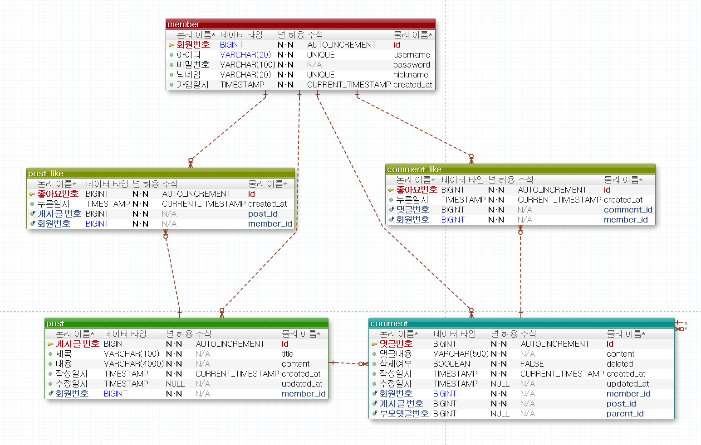

# ERD 설계



## 1. 개요
- 테이블 5개: `member`, `post`, `comment`, `post_like`, `comment_like`
- 이름 규칙: 소문자 snake_case. 모든 테이블의 PK는 `id` (BIGINT, 자동 증가)

## 2. 테이블 정의서

### member (회원)
| 논리명 | 물리명 | 타입 | NULL | 키 | 기본값 |
|---|---|---|---|---|---|
| 회원번호 | id | BIGINT | N | PK | 자동 증가 |
| 아이디 | username | VARCHAR(20) | N | UK | |
| 비밀번호 | password | VARCHAR(100) | N | | |
| 닉네임 | nickname | VARCHAR(20) | N | UK | |
| 가입일시 | created_at | TIMESTAMP | N | | CURRENT_TIMESTAMP |

### post (게시글)
| 논리명 | 물리명 | 타입 | NULL | 키 | 기본값 |
|---|---|---|---|---|---|
| 게시글번호 | id | BIGINT | N | PK | 자동 증가 |
| 회원번호 | member_id | BIGINT | N | FK → member | |
| 제목 | title | VARCHAR(100) | N | | |
| 내용 | content | VARCHAR(4000) | N | | |
| 작성일시 | created_at | TIMESTAMP | N | | CURRENT_TIMESTAMP |
| 수정일시 | updated_at | TIMESTAMP | Y | | |

### comment (댓글)
| 논리명 | 물리명 | 타입 | NULL | 키 | 기본값 |
|---|---|---|---|---|---|
| 댓글번호 | id | BIGINT | N | PK | 자동 증가 |
| 게시글번호 | post_id | BIGINT | N | FK → post | |
| 회원번호 | member_id | BIGINT | N | FK → member | |
| 부모댓글번호 | parent_id | BIGINT | Y | FK → comment | |
| 댓글내용 | content | VARCHAR(500) | N | | |
| 삭제여부 | deleted | BOOLEAN | N | | FALSE |
| 작성일시 | created_at | TIMESTAMP | N | | CURRENT_TIMESTAMP |
| 수정일시 | updated_at | TIMESTAMP | Y | | |

### post_like (게시글 좋아요)
| 논리명 | 물리명 | 타입 | NULL | 키 | 기본값 |
|---|---|---|---|---|---|
| 좋아요번호 | id | BIGINT | N | PK | 자동 증가 |
| 게시글번호 | post_id | BIGINT | N | FK → post, 복합 UK | |
| 회원번호 | member_id | BIGINT | N | FK → member, 복합 UK | |
| 누른일시 | created_at | TIMESTAMP | N | | CURRENT_TIMESTAMP |

### comment_like (댓글 좋아요)
| 논리명 | 물리명 | 타입 | NULL | 키 | 기본값 |
|---|---|---|---|---|---|
| 좋아요번호 | id | BIGINT | N | PK | 자동 증가 |
| 댓글번호 | comment_id | BIGINT | N | FK → comment, 복합 UK | |
| 회원번호 | member_id | BIGINT | N | FK → member, 복합 UK | |
| 누른일시 | created_at | TIMESTAMP | N | | CURRENT_TIMESTAMP |

## 3. 설계 결정과 이유

### 1. 대댓글은 1단계로 제한
```
댓글 A
├─ 대댓글 B
└─ 대댓글 C
```
- `parent_id`는 항상 최상위 댓글을 가리킴
- 답글에 다시 답글을 달면 같은 부모 아래에 붙고, 내용 앞에 @닉네임 표시
- 이유: 단계가 깊어지면 조회 쿼리와 화면 구성이 복잡해짐

### 2. 좋아요는 별도 테이블 + 복합 UNIQUE
- `(post_id, member_id)`, `(comment_id, member_id)` 조합에 UNIQUE
- 이유: 버튼을 연속으로 눌러도 DB에서 중복 저장을 막기 위함

### 3. 좋아요 수는 COUNT로 계산
- 카운터 컬럼을 따로 두지 않음
- 이유: 동시에 요청이 몰리면 카운터 값이 실제 좋아요 수와 어긋날 수 있음

### 4. 답글이 있는 댓글만 소프트 삭제
- 답글이 있으면 `deleted = TRUE`로 바꾸고 "삭제된 댓글입니다"로 표시
- 답글이 없으면 실제로 삭제, 삭제 표시된 부모의 마지막 답글이 지워지면 부모도 함께 삭제
- 이유: 다른 사람이 단 답글까지 함께 사라지는 것을 막기 위함

### 5. ON DELETE CASCADE 미사용
- 게시글 삭제 시 서비스의 `@Transactional` 안에서 자식부터 순서대로 삭제
- 순서: 댓글 좋아요 → 답글 → 댓글 → 게시글 좋아요 → 게시글
- 이유: 삭제 범위와 순서를 코드에서 명확히 관리하고, 중간에 실패하면 전체를 되돌리기 위함

### 6. `updated_at`이 NULL이면 수정 전
- 수정할 때만 값이 채워짐
- 이유: "(수정됨)" 표시 여부를 구분하기 위함

### 7. 테이블 이름 `member`, `post_like`
- 이유: `user`, `like`는 H2 예약어라 충돌함

### 8. id는 BIGINT
- 이유: 삭제해도 번호를 재사용하지 않고 계속 증가하므로 범위를 넉넉히 확보

### 9. role 컬럼 없음
- 이유: 관리자 기능이 없어 로그인한 회원은 모두 일반 사용자로 동일하게 처리
